<div align="center">
  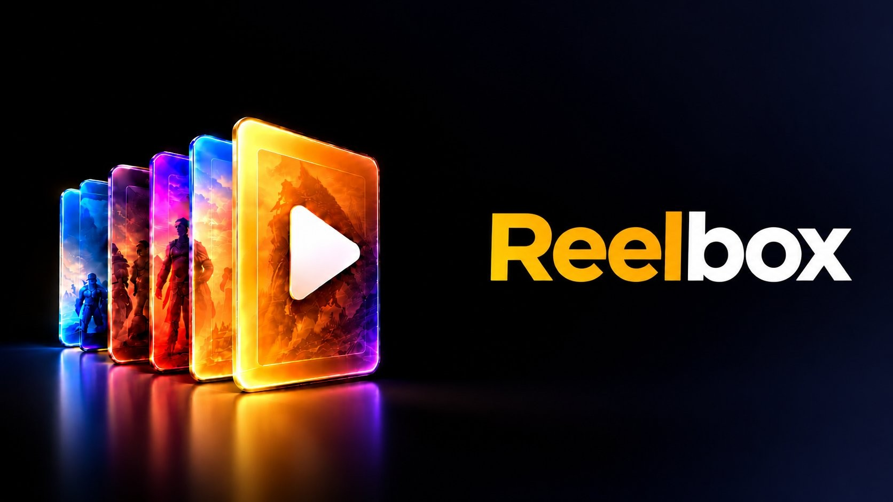
  <h1>Reelbox</h1>
  <p>为电视而生：极简界面、丝滑焦点、一面壮观的 4K 海报墙。</p>
  <p>作者：<a href="https://github.com/Eddyyyyyyyyyyyyyy">Eddy</a> · 平台：Android TV · 版本见 <a href="https://github.com/Eddyyyyyyyyyyyyyy/Reelbox/releases">Releases</a></p>
  <p><a href="#安装与开始使用">安装</a> · <a href="#构建">构建</a> · <a href="CHANGELOG.md">更新记录</a> · <a href="SECURITY.md">安全说明</a> · <a href="LICENSE">许可证</a></p>
</div>

> **本项目仅为播放与内容管理工具，不内置、不提供、不托管、不售卖任何影视资源，也不提供订阅地址、账号或会员权益。内容与配置需由用户自行合法获取，并确保拥有相应访问和使用权。**

## Reelbox

Reelbox 主要是想自己用，现在媒体库和在线播放器老是分开在用，能用在一起的又有点丑，弄了个都是海报墙的缝合怪，有兴趣朋友可以一起试试

- **极简**：主界面只有四个入口，没有广告位、没有推荐弹窗、没有多余按钮。
- **流畅**：方向键只去视觉上最近的一行，左右不串行；从播放返回时，焦点回到刚才那一集。
- **海报墙**：在线源与片库共用同一面全屏海报墙——整屏海报、同一套焦点走位、同样的横图背景。
- **简单**：装上、导入自己的配置、开播，三步完成，不需要教程。

Reelbox 用 Kotlin、Jetpack Compose 与原生 View 实现，不预装任何片库，
第一次使用时导入你有权使用的配置即可。

## 截图

| 经典 | 沉浸画廊 |
| --- | --- |
| 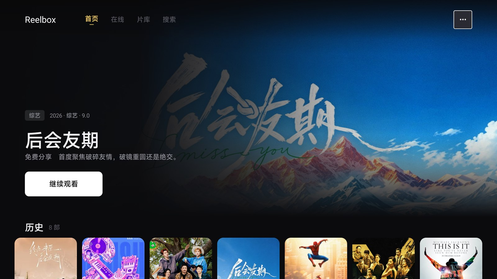 | 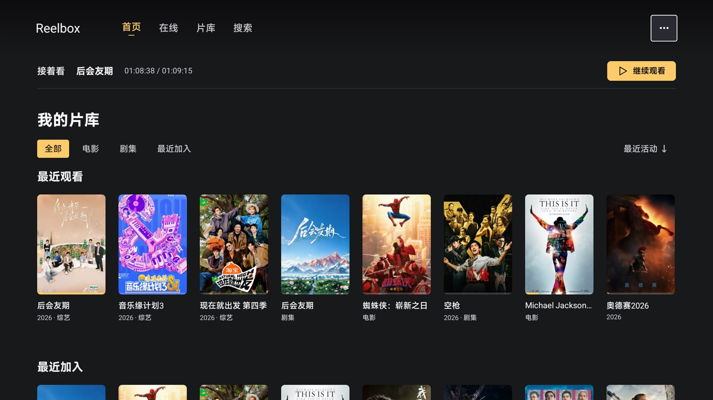 |

| 侧栏影院 | 顶栏简约 |
| --- | --- |
| 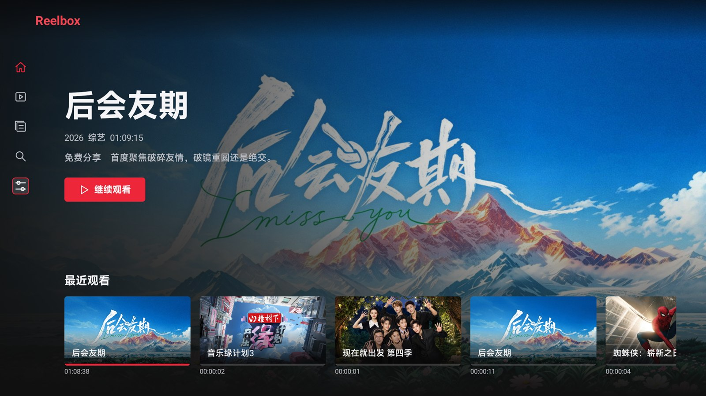 |  |

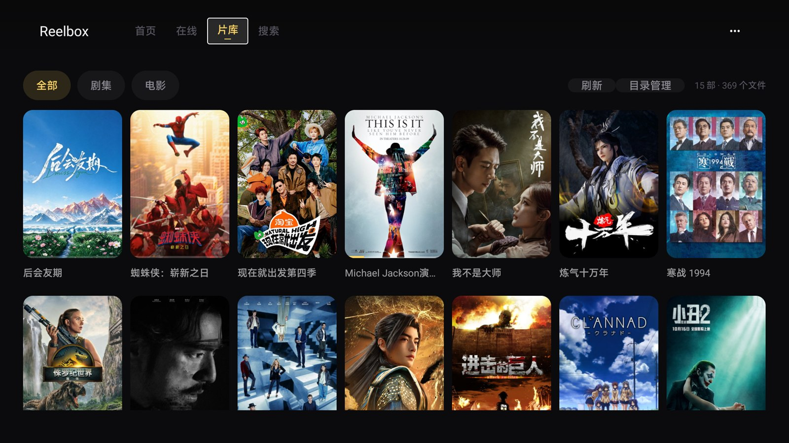

> 截图中的影片名称与海报来自演示用的个人片库，仅用于展示界面，不代表本项目内置或提供这些内容。

### 更多界面

| 首页导航 | 详情页 |
| --- | --- |
| 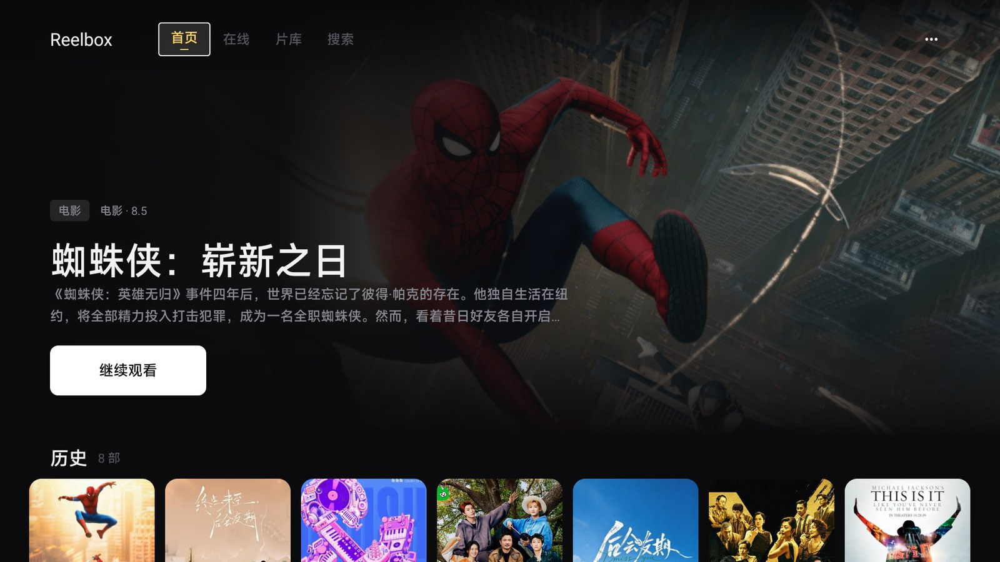 | 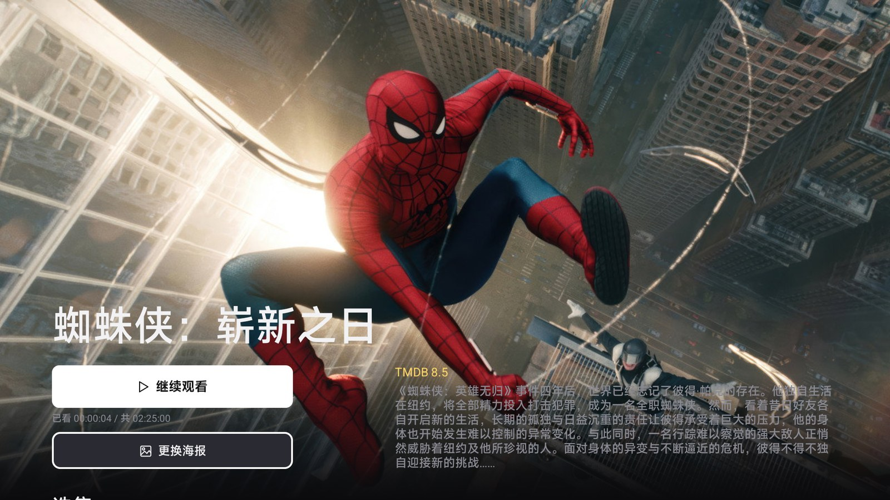 |

| 更换海报 | 选集列表 |
| --- | --- |
| 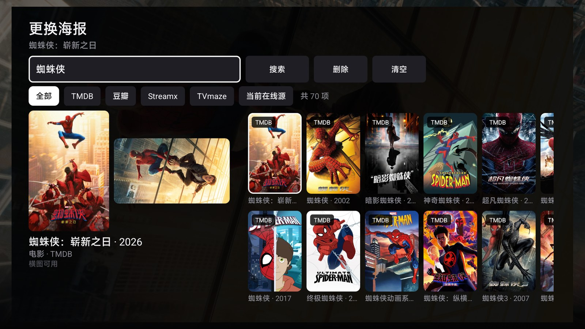 | 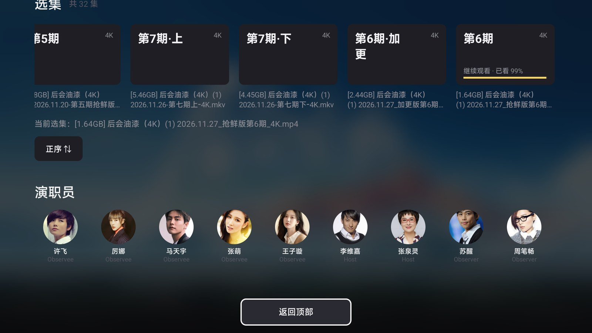 |

| 播放器面板 | 播放中选集 |
| --- | --- |
| 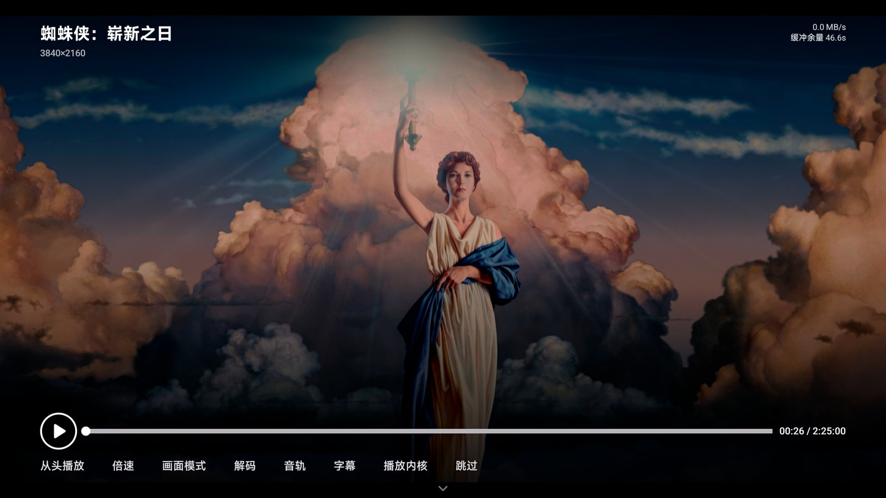 | 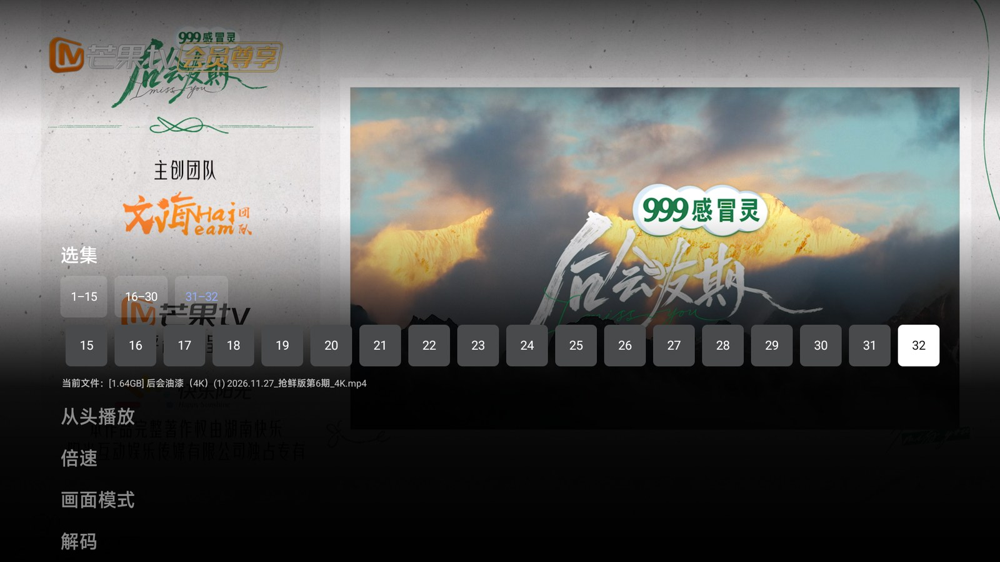 |

### UI 设计上的几个取舍

- **遥控器优先**：方向键只走到视觉上最近的一行，不串行；从播放页返回，焦点回到刚才那一集，不用重新找位置。
- **10 英尺可读性**：标题 44sp、播放按钮 260×46dp、剧集卡 180×100dp，按 1920×1080 电视实测尺寸定的，不是手机 UI 放大。
- **焦点态统一**：全站白 2dp 描边、不缩放；白底按钮聚焦时换强调色，避免出现"白底白框看不见"的情况。
- **信息密度可控**：详情页两栏布局，左侧标题+播放+线路，右侧元信息+简介；剧集横轨用 Leanback 原生 View，100 集只组合视口内 6~7 张卡，连按不卡。
- **海报不将就**：在线源和片库共用同一面海报墙，海报或横图不满意可直接换，候选图按来源分组展示。

## 能做什么

| 功能 | 当前能力 |
| --- | --- |
| 电视端导航 | 首页 / 在线 / 片库 / 搜索四个一级页面；遥控器方向键走位、焦点记忆、跨行只落到最近行 |
| 内容源 | TVBox 订阅（JSON、加密 JSON、clan 等）；jar 型、JS 型、JSON 型站点 |
| 片库 | Alist、WebDAV、Emby / Jellyfin；目录规则与目录管理、多来源合并；Alist / WebDAV 可直接在应用内删除文件 |
| 海报 | 在线源与片库共用同一套海报墙；可手动更换海报与横图，按来源浏览候选图 |
| 播放内核 | AndroidX Media3（ExoPlayer）、libVLC、系统播放器；失败按 Exo → VLC → 系统自动兜底，面板显示实际内核并保留进度 |
| 画面与音轨 | 适应 / 拉伸 / 剪裁 / 原始；倍速、音轨与字幕切换、片头片尾跳过 |
| 进度与历史 | 续播、播放历史、进度条；返回详情页把焦点还给刚播过的那一集 |
| 局域网推送 | 同一局域网用手机扫码填写配置，电视端直接接收 |
| 数据 | 播放历史、设置、Cookie、海报缓存全部保存在本机，无统计与远程日志 |

## 安装与开始使用

1. 在 [Releases](https://github.com/Eddyyyyyyyyyyyyyy/Reelbox/releases) 下载 APK，并核对随附的 SHA-256。
2. 安装到电视或盒子：
   - `adb install -r Reelbox-<version>-vc<code>.apk`
   - 或用电视上的文件管理器打开 APK。
3. 打开应用 → 设置 → 在线，填写你有权使用的订阅地址；或在片库页配置 Alist / WebDAV / Emby。
4. 导入完成后回到首页，从继续观看或海报墙进入详情页选集播放。

> Release 包目前使用 debug 签名，方便覆盖安装与本地测试；它不是应用商店的发布签名。
> 卸载应用会清空本地历史与配置，升级前请留意。

## 设备与兼容性

- **系统**：Android 5.0（API 21）及以上；当前实机验证环境为 Android 14 的小米电视。
- **架构**：APK 只包含 `arm64-v8a` 与 `armeabi-v7a`，电视与盒子均为 ARM；x86 仅用于模拟器调试。
- **网络**：允许明文 HTTP，用于局域网 Alist / WebDAV / Emby；公网使用请改 HTTPS。
- **第三方插件**：订阅里的 spider jar 会在应用进程内执行，请只加载可信来源，详见 [SECURITY.md](SECURITY.md)。

功能存在不代表任意配置、站点或编码都兼容；遇到问题请提交 Issue，但不要附带账号、Cookie、订阅地址或二维码。

## 构建

要求：

- JDK 17
- Android SDK 35（compileSdk 35 / targetSdk 34 / minSdk 21）
- NDK 27.0.12077973、CMake 3.22.1（QuickJS 与 FFmpeg 扩展）

```bash
./gradlew :app:assembleDebug
./gradlew :app:assembleRelease
```

产物在 `dist/Reelbox-<version>-vc<code>.apk`（该目录已被 Git 忽略），发布请走 GitHub Releases。

## 项目结构

```text
app/                Android 应用（Kotlin + Compose + 原生 View）
media3-ffmpeg/      FFmpeg 音频解码扩展（LGPL，含构建说明）
assets/             README 使用的界面截图
scripts/            构建与校验脚本
```

## 第三方组件

感谢 AndroidX Media3、libVLC、FFmpeg、QuickJS、OkHttp、kotlinx.serialization、Room、Coil、ZXing、Leanback 等项目。
它们保留各自作者署名与许可，FFmpeg 的源码与可重链接材料说明见 [NOTICE](app/src/main/assets/licenses/NOTICE.txt)。

## 支持作者

Reelbox 由个人业余维护：代码开源、免费使用，没有任何付费功能或功能限制。
如果它确实帮你省了时间、看得更舒服，欢迎扫码请作者喝杯咖啡；不捐也完全不影响使用。

| 支付宝 | 微信 |
| --- | --- |
|  |  |

也欢迎 Star、提 Issue 或反馈兼容性问题，这些同样是实实在在的帮助。

## 许可证与声明

本项目代码按 [GNU GPL v3](LICENSE) 发布；第三方组件继续适用各自许可。

本项目不承诺第三方内容的合法性、准确性、可用性或持续性，也不提供绕过付费、访问控制或数字版权保护的功能。
请不要在本仓库提交资源分享、侵权内容或账号交易请求。
